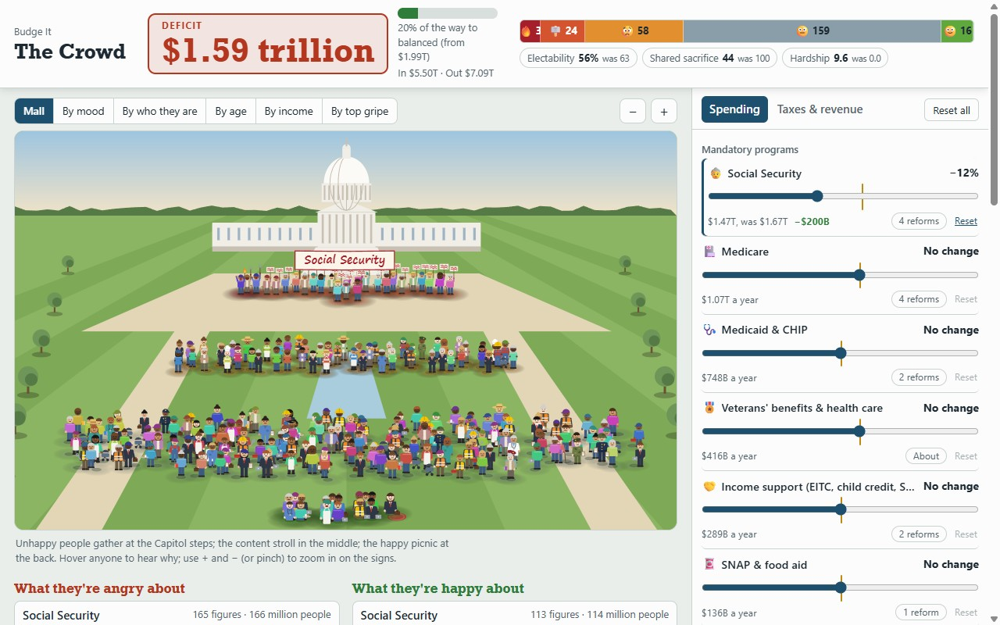
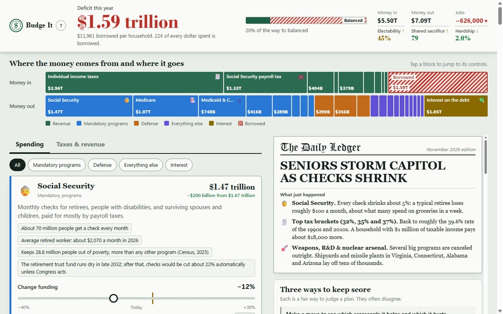

# Budge It

**Can you balance the US federal budget, and who pays when you do?**

The federal government spends about $2 trillion a year more than it takes in. Budge It
is a small collection of browser games that hand you every spending line and tax lever
and let you close the gap yourself, then show what your plan does to real people. Same
real numbers in every game; a different way of looking at them in each.

No install, no build, no account, no tracking. It is plain HTML and JavaScript that
runs offline.



## Play

**[Play it in your browser](https://payneba.github.io/budge-it/)**

Or run it locally: download or clone the repo and open `index.html`.

```sh
git clone https://github.com/payneba/budge-it.git
# then open budge-it/index.html
```

## The games

### The Crowd (`games/crowd/`)

260 little people stand on the National Mall, each representing about a million
American adults: retirees, nurses, students, farmers, soldiers, welders at defense
plants, postdocs, small-business owners. Move a slider and they react. The content
picnic at the back; the unhappy pick up signs and gather at the Capitol steps; the
furious bring torches and pitchforks.

- Hover anyone to hear what they are reacting to, in their own words and with real
  numbers ("$230 a month less from my Social Security check").
- Click anyone for everything on their mind and a link to the control that caused it.
- Regroup the crowd by mood, by who they are, by age, by income, or by top gripe.
- People react to more than their own wallet: lost coverage, a job that depends on a
  budget line, and worries with no price tag, such as national security, their kids'
  future, the climate, and the national debt itself.

How the simulation works, and what is sourced versus estimated, is in
[games/crowd/README.md](games/crowd/README.md).

### The Ledger (`games/ledger/`)

The full dashboard: every budget line and tax option as a card with facts and
consequences, a money-in / money-out bar, eight example households around the kitchen
table, voter blocs, a newspaper front page that reacts to your plan, a ten-year debt
outlook, challenges ("no new taxes", "don't touch Social Security or Medicare"), and
shareable plan links.



## Three ways to keep score

There is no single right answer to "how did people take it", so the games score a
plan three ways, side by side. They pull against each other on purpose.

- **Electability**: will voters re-elect you? Anger saturates: once a group is
  furious, more pain costs you little. This rewards loading the pain onto a few groups.
- **Shared sacrifice**: is the burden spread evenly, so nobody feels singled out?
  It ignores how big the burden is: everyone losing a fifth of their pay scores
  perfectly.
- **Hardship**: how much does it hurt in total? Big losses count far more than small
  ones, and a dollar counts more to a poorer household.

A plan tuned for one usually scores badly on another.

## About the numbers

- The baseline is fiscal year 2026 actuals: $7.40 trillion out, $5.40 trillion in, a
  $1.99 trillion deficit. Budget totals come from the US Treasury's Monthly Treasury
  Statement; most policy options are scaled from Congressional Budget Office and
  Committee for a Responsible Federal Budget scores. Every source is listed in
  `meta.sources` in `shared/data.js` and shown in each game under "About the numbers".
- **This is a simplified model, not a forecast.** Each option is a single annual
  number; options simply add up; the economy responds through one GDP figure.
- **Many numbers are estimates.** The dollar effects on example households, how
  strongly each group reacts, jobs per dollar of spending, and how widely each worry is
  held are judgment calls, informed by published data where it exists. Several policy
  scores predate recent tax law changes. Treat the output as a way to understand
  trade-offs, not as a prediction.
- The games try to be non-partisan: every option has real costs and real
  beneficiaries, and both are shown. If something reads as slanted or wrong, please
  open an issue.

More detail: [Model simplifications](#model-simplifications) below.

## How this was built

Budge It was built with [Claude Code](https://claude.com/claude-code). AI agents
researched the data, wrote the content and the code, and tested the result under human
direction. The text and numbers have not all been checked line by line by a person.
`CLAUDE.md` is the working specification the agents followed: the data schema, the
engine's rules, and the conventions for adding a game.

## For developers

### Layout

| Path | Purpose |
|------|---------|
| `index.html` | Landing page listing the games |
| `shared/data.js` | `BUDGET_DATA`: every budget number and every word of policy text |
| `shared/model.js` | `BudgetModel`: pure calculation, validation, share codes, formatting |
| `games/ledger/` | The Ledger: `index.html`, `app.js`, `style.css` |
| `games/crowd/` | The Crowd: `people.js` (who is in the crowd and what they care about), `crowd-model.js` (simulation), `crowd.js` (canvas and controls), `index.html`, `style.css` |
| `tests/` | `node:test` suites and a small fixture dataset |
| `CLAUDE.md` | Data schema, engine semantics, rules for adding a game |

Everything is vanilla JavaScript loaded with classic `<script>` tags, so each game
works from a `file://` URL and from any static host. There are no runtime dependencies.

The engine and both games are data-driven: no budget line, lever or figure is
hard-coded. New games go side by side in `games/<name>/` and share `shared/`.

### Tests

```sh
node --test tests/
```

Node 24 or later, no dependencies. The suites check the engine against a small
invented dataset, check that the real data validates and that the game is winnable,
and check the crowd simulation (including that no budget control is "free": every one
must matter to somebody in the crowd).

### Adding or editing a policy option

Add an object to `levers` in `shared/data.js`. It appears in every game with no code
change.

```js
{
  id: "corp_rate",                 // unique across spending, revenue and levers
  parent: "corporate_income_tax",  // the spending or revenue line it belongs to
  side: "revenue",                 // must match the parent: "revenue" or "spending"
  type: "slider",                  // or "toggle"
  name: "Corporate income tax rate",
  blurb: "Plain-language description of the change.",
  unit: "%", min: 15, max: 35, step: 1, current: 21,   // sliders only
  budgetPerUnit: 13,               // $B per unit above `current` (toggle: $B when on).
                                   // Revenue: added revenue. Spending: added spending (negative saves).
  falloff: 0.15,                   // optional 0..0.6: behavioral response at the slider ends
  stories: [{ at: 28, text: "..." }],   // sliders; `at` is an absolute slider value
  onText: "...",                   // toggles: what happens when switched on
  source: "CBO Options for Reducing the Deficit, 2024",
  effects: { metrics: {}, personas: {}, approval: {}, gdpPct: 0 }  // per unit, or when on
}
```

Then run the tests. Validation reports anything that doesn't line up, and The Crowd's
tests will fail until the new option is wired to someone in `games/crowd/people.js`.
The full schema is in `CLAUDE.md`.

### Model simplifications

- Every estimate is a single, fully phased-in annual number at the scale of the
  baseline year. Real policies phase in, interact and change over time.
- Effects are linear per unit of change, apart from `falloff` (taxpayers respond
  more to bigger rate changes) and reactions that saturate.
- Options are independent and simply add up. In reality some overlap (two ways of
  taxing the same income) or interact.
- The economy responds through one number: each option's short-run GDP effect.
  GDP changes feed back into revenue and into jobs, using fixed ratios.
- Interest on the debt moves by half a year of interest on the change in this year's
  borrowing. In the ten-year outlook the current-law deficit grows at a fixed rate,
  your policy change grows with the economy, and the extra (or reduced) debt
  compounds at the average interest rate.
- In The Ledger, the household scorecards count only direct dollar effects on eight
  example households, so cuts to research, roads, housing aid or weapons barely
  register there. The Crowd was built to address that: its people also react to lost
  services, jobs and non-monetary worries.
- Balancing in a single year is harsher than any real plan, which would phase in over
  a decade or more.

## License

[MIT](LICENSE)
